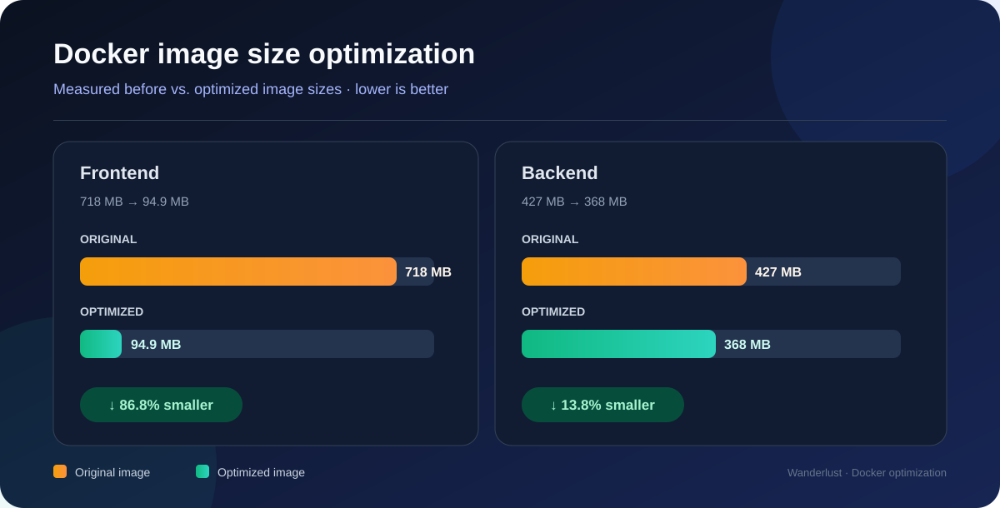
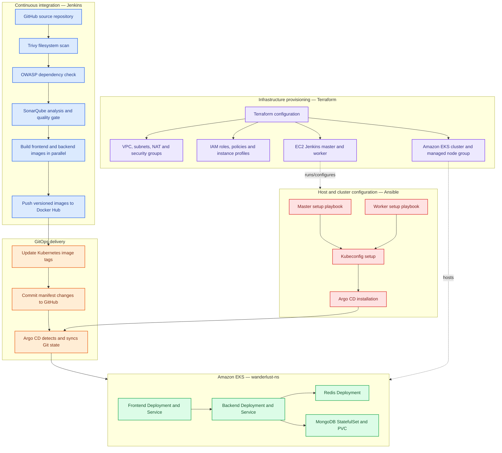

<div align="center">

# 🌍 Wanderlust — DevSecOps & GitOps Automation

### From a manually assembled MERN deployment to an Infrastructure-as-Code and GitOps workflow

<p>
  <a href="https://github.com/snehalpawar29/wanderlust-devops-automation"></a>
  <a href="https://aws.amazon.com/eks/"></a>
  <a href="https://www.terraform.io/"></a>
  <a href="https://www.jenkins.io/"></a>
  <a href="https://argo-cd.readthedocs.io/"></a>
</p>

<p>
  
  
  
  
  
  
  
  
</p>

**My DevOps implementation:** [snehalpawar29/wanderlust-devops-automation](https://github.com/snehalpawar29/wanderlust-devops-automation)  
**Original application and learning reference:** [LondheShubham153/Wanderlust-Mega-Project](https://github.com/LondheShubham153/Wanderlust-Mega-Project)

</div>

---

## 📌 Project overview

Wanderlust is a three-tier MERN travel-blog application. This repository builds on the original Wanderlust Mega Project by focusing on the **platform, infrastructure, delivery automation and Kubernetes deployment** rather than claiming ownership of the original application code.

The implementation uses **Terraform** to provision AWS infrastructure, **Ansible** to configure hosts and Kubernetes tooling, **Jenkins** to run the CI and image-release stages, and **Argo CD** to reconcile Kubernetes manifests from GitHub into Amazon EKS.

> **Project attribution:** The application is based on [LondheShubham153/Wanderlust-Mega-Project](https://github.com/LondheShubham153/Wanderlust-Mega-Project). This repository documents my infrastructure, containerization, CI/CD, GitOps and Kubernetes work on top of that application.

## ✨ Results at a glance

| Improvement | Before | After | Recorded result |
|---|---:|---:|---:|
| Frontend Docker image | 718 MB | 94.9 MB | **86.8% smaller** |
| Backend Docker image | 427 MB | 368 MB | **13.8% smaller** |

<div align="center">



</div>


## 🏗️ Architecture



### Release flow

1. Jenkins checks out this repository and runs Trivy, OWASP Dependency-Check and SonarQube quality-gate stages.
2. Frontend and backend images are built in parallel, tagged with the Jenkins build number and pushed to Docker Hub.
3. The pipeline updates the Kubernetes deployment manifests and commits the new image references to GitHub.
4. Argo CD watches the Git repository and synchronizes the desired manifests to the EKS cluster.
5. Kubernetes rolls out the updated workloads and Services route traffic to ready pods.

## 🔄 How this improves the original project

The original repository provides the MERN application and a detailed manual implementation guide. My repository keeps that application direction and changes how the infrastructure and delivery platform are created, configured and operated.

| Area | Original project/reference | This implementation |
|---|---|---|
| AWS infrastructure | Guided AWS Console and `eksctl` setup steps | Terraform resources/modules for VPC networking, IAM, EC2, EKS cluster and managed node group |
| Host configuration | Installation commands performed on the master and worker | Ansible playbooks for master tools, worker tools, kubeconfig and Argo CD setup |
| Jenkins workflow | Separate CI and CD Jenkins jobs in the reference flow | A consolidated Jenkinsfile runs scans, builds, image pushes and manifest updates in one pipeline |
| Frontend container | Node 21 image running the Vite development server | Node 22 Alpine build stage followed by an Nginx Alpine runtime serving the built frontend |
| Backend container | Node 21 build/runtime approach with `npm install` | Node 22 slim multi-stage build, `npm ci`, production-only dependencies and selected runtime files |
| Kubernetes workloads | Original guide describes EKS deployment and Argo CD, with app manifests managed separately | This repository defines two frontend and two backend replicas, health probes and CPU/memory requests and limits |
| Service exposure | Frontend and backend exposed using NodePort in the reference manifests | Frontend exposed using NodePort; backend uses an internal ClusterIP Service |
| Startup and health | Basic workload definitions | Backend init container waits for Redis; deployments include startup, readiness and liveness probes |
| Data persistence | MongoDB and Redis are part of the reference application stack | MongoDB StatefulSet uses a PersistentVolumeClaim; Redis runs as a Kubernetes Deployment |
| Observability | Original guide includes Prometheus and Grafana installation using Helm | Monitoring installation/manifests are not currently part of this repository's checked-in automation |
| Automated tests | Original backend Docker build runs `npm run test` | The current Jenkinsfile does not show a dedicated application test stage; adding one is a recommended next step |
| GitOps source | Reference CD job updates the original application's manifests | This repository maintains its own Kubernetes manifests for Argo CD reconciliation |

**Security tooling is retained and integrated into the CI pipeline.** The original project already documents Trivy, OWASP Dependency-Check and SonarQube; the improvement here is how these checks fit into the consolidated pipeline and image-release flow, not a claim that the tools were newly invented in this repository. The original project also documents Prometheus/Grafana monitoring and a backend test command; those are not yet represented as automated stages or checked-in monitoring resources in this repository, so they remain clear follow-up improvements.

## 🧱 Infrastructure as Code — Terraform

The `terraform/` directory defines the AWS foundation in `ap-south-1`:

- VPC module with public, private and intra subnet definitions across two Availability Zones, plus NAT gateway configuration.
- Security group rules, EC2 key pairs and IAM roles/instance profiles.
- EC2 instances for the Jenkins master and Jenkins worker.
- Amazon EKS cluster, managed node group, OIDC provider, EKS access entry and cluster-admin association.
- Terraform outputs for VPC ID, cluster endpoint, node group name and instance/node addresses.
- Provisioners invoke Ansible playbooks for host configuration, kubeconfig setup and Argo CD installation.


## 🛠️ Configuration management — Ansible

| Playbook | Responsibility |
|---|---|
| `ansible/master_setup.yaml` | Installs Docker, Jenkins, AWS CLI, Kind, kubectl, eksctl and configures a SonarQube container with persistent Docker volumes |
| `ansible/jenkins_worker_setup.yaml` | Installs Java prerequisites, Docker, AWS CLI and Trivy on the Jenkins worker |
| `ansible/update-kubeconfig.yaml` | Configures kubectl access to `wanderlust-cluster` |
| `ansible/argocd_setup.yaml` | Creates the Argo CD namespace, applies Argo CD manifests and waits for pods to become Ready |

## 🔐 CI pipeline — Jenkins

The root `Jenkinsfile` uses the `Shared` Jenkins Shared Library and a worker labeled `Node`.

| Stage | Purpose |
|---|---|
| Clean workspace and clone | Prepare the Jenkins workspace and check out `main` |
| Trivy scan | Filesystem security scan through the shared library |
| OWASP | Dependency vulnerability check through the shared library |
| SonarQube analysis | Static code analysis |
| SonarQube quality gate | Enforce the configured quality-gate result |
| Build images | Build frontend and backend images in parallel |
| Push images | Push both versioned images to Docker Hub in parallel |
| Update Kubernetes manifests | Update image tags and push the GitOps changes to GitHub |
| Post actions | Clean workspace and send success/failure email notifications |

Image repositories used by the pipeline:

- `snehalpawar2945/wanderlust-frontend:<BUILD_NUMBER>`
- `snehalpawar2945/wanderlust-backend:<BUILD_NUMBER>`

The Jenkins Shared Library must be configured in Jenkins, and its credential IDs (`Docker` and `Github`) must exist in the Jenkins credential store. Secrets are not meant to be stored in this README or committed in source files.

## 📦 Container improvements

### Frontend

- Builds the Vite application using `node:22-alpine`.
- Uses `npm ci` for lockfile-based dependency installation.
- Copies the compiled `dist/` output into `nginx:alpine` for static production serving.
- Does not ship the Node.js build environment in the final runtime image.

### Backend

- Uses Node 22 slim build and production stages.
- Installs dependencies with `npm ci`.
- Installs only production dependencies in the final stage using `npm ci --omit=dev`.
- Copies the runtime application directories into the production image.

## ☸️ Kubernetes deployment

The manifests are under `kubernetes/` and target namespace `wanderlust-ns`.

| Workload | Configuration in repository |
|---|---|
| Frontend | Deployment with 2 replicas; NodePort Service on port `30080` |
| Backend | Deployment with 2 replicas; internal ClusterIP Service |
| Redis | Deployment and ClusterIP Service; startup/readiness/liveness checks |
| MongoDB | StatefulSet with persistent volume claim and health checks |

Additional deployment controls include:

- CPU and memory requests/limits for frontend, backend, MongoDB and Redis.
- Startup, readiness and liveness probes for application workloads.
- Backend init container waits for the Redis service before starting the application container.
- MongoDB data is mounted from a PersistentVolumeClaim.

Useful verification commands:

```bash
kubectl get nodes -o wide
kubectl get deployments,pods,services -n wanderlust-ns
kubectl get pvc -n wanderlust-ns
kubectl get applications.argoproj.io -n argocd
```

## 🧪 Run locally with Docker Compose

The repository includes `docker-compose.yml` for a local frontend, backend, MongoDB and Redis stack with a custom bridge network and a MongoDB named volume.

1. Create the ignored `backend/.env.docker` and `frontend/.env.docker` files with local development values. Do not commit real credentials.
2. Ensure the backend uses the Compose service names for MongoDB and Redis (`mongodb` and `redis`) rather than `localhost`.
3. Start the stack:

```bash
docker compose up -d --build
```

Check services and logs:

```bash
docker compose ps
docker compose logs -f
```

Stop the stack:

```bash
docker compose down
```

The named MongoDB volume is retained by `docker compose down`; use `docker compose down -v` only when you deliberately want to delete local database data.


## 📁 Repository layout

```text
.
├── Assets/                 # Project diagrams and charts
├── Automations/            # Environment update scripts
├── ansible/                # Master, worker, kubeconfig and Argo CD playbooks
├── backend/                # Node.js API
├── frontend/               # React/Vite frontend
├── kubernetes/             # Deployments, Services, StatefulSet and storage manifests
├── terraform/              # AWS VPC, EC2, IAM and EKS resources
├── docker-compose.yml      # Local multi-container setup
├── Jenkinsfile             # Consolidated CI pipeline
└── README.md
```

## 🚀 Reproduce the infrastructure workflow

Prerequisites: AWS credentials with appropriately scoped permissions, Terraform `>= 1.5.7`, Ansible, AWS CLI, an SSH key pair for the EC2/EKS configuration, Docker, kubectl and Helm/Argo CD tooling as required by your environment.

```bash
cd terraform
terraform init
terraform fmt -check
terraform validate
terraform plan
```

Review the plan carefully before applying it:

```bash
terraform apply
```

Terraform creates billable AWS resources, including NAT gateway, EC2 and EKS resources. Check regional quotas and estimated costs first. Do not apply this configuration to an existing environment with a missing or incorrect Terraform state file.

## 🔒 Security and production-hardening checklist

This is a learning/portfolio environment, not a production security baseline. Before production use:

- Rotate any JWT signing secret that has been committed to the public repository. The current tracked `kubernetes/secrets.yaml` contains a JWT secret value; treat it as exposed, remove the value from the repository/history, and replace it with a safe template or an external secret-management integration.
- Restrict security-group ingress currently configured with broad `0.0.0.0/0` sources. In particular, do not expose SSH, Jenkins, SonarQube, Redis, the Kubernetes API or the full NodePort range to the public internet.
- Replace broad `AdministratorAccess` attachments on EC2 roles with least-privilege IAM policies.
- Pin mutable image tags such as `latest` to explicit versions or digests.
- Keep Terraform state encrypted and access-controlled; never commit state files, private keys, `.env.docker` files or live credentials.
- Use TLS and authenticated access for Jenkins, Argo CD and monitoring endpoints.

## 🙌 Credits

- Original application and implementation reference: [LondheShubham153/Wanderlust-Mega-Project](https://github.com/LondheShubham153/Wanderlust-Mega-Project)
- This repository's DevOps automation and infrastructure work: [Snehal Pawar](https://github.com/snehalpawar29)

## 👩‍💻 Author

**Snehal Pawar**  
Cloud & DevOps Engineer | AWS | Kubernetes | CI/CD | Infrastructure Automation

- GitHub: [@snehalpawar29](https://github.com/snehalpawar29)
- LinkedIn: [snehalpawar29](https://linkedin.com/in/snehalpawar29)

---

<div align="center">

**Built to practice repeatable infrastructure, secure delivery workflows and GitOps-based application operations.**

</div>
