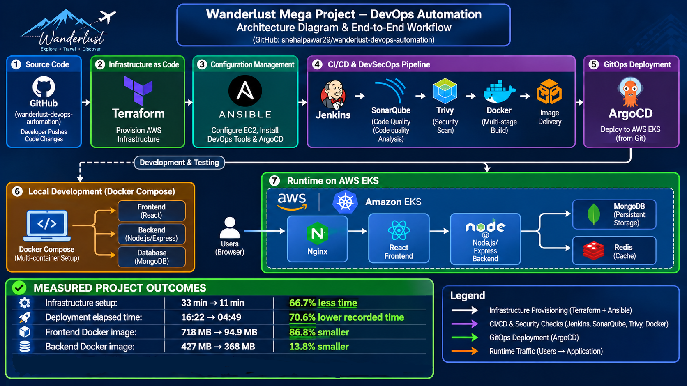
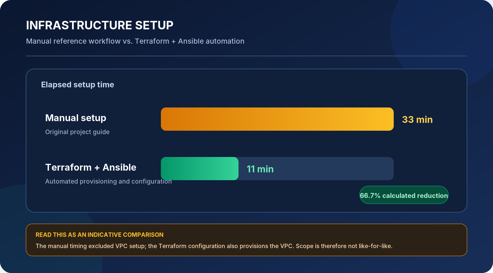
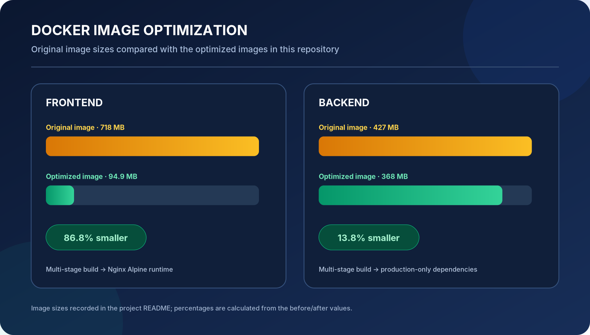
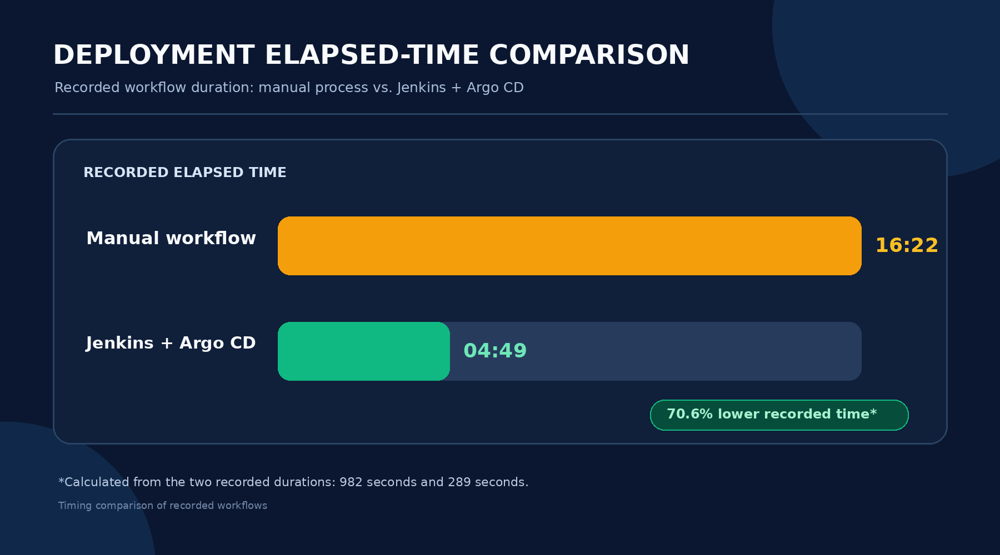

🌍 Wanderlust — DevSecOps & GitOps Automation

  <strong>Rebuilding the delivery platform with Infrastructure as Code, CI/CD, Security Automation and GitOps.</strong>
    
  
  
  
  
  
  
  

  <a href="https://github.com/snehalpawar29/wanderlust-devops-automation">My DevOps Implementation</a>
  &nbsp; • &nbsp;
  <a href="https://github.com/LondheShubham153/Wanderlust-Mega-Project">Original Application</a>

---

🏗️ Architecture

  

---

🎯 Project Overview

The original Wanderlust MERN travel-blog application and its deployment walkthrough are credited to "LondheShubham153" (https://github.com/LondheShubham153). I used that project as the application and learning reference, then rebuilt the DevOps and deployment side in my own repository. My goal was to move away from manually creating AWS resources and installing/configuring tools step by step, and create a more repeatable workflow: provision infrastructure with Terraform, configure EC2 and Kubernetes tooling with Ansible, run security and code-quality checks in Jenkins, package optimized Docker images, and deploy Kubernetes changes through GitHub and Argo CD. The original application is credited to its owner; this repository focuses on my infrastructure, automation, containerization, CI/CD and GitOps implementation.

---

🚀 What I Improved

1. ☁️ Terraform + Ansible — Infrastructure Automation

I automated AWS infrastructure provisioning and server configuration using Terraform and Ansible, replacing much of the original workflow's manual resource creation and tool installation with reusable automation.

✨ What I changed

- Terraform: Declared the VPC, subnets across two Availability Zones, NAT Gateway, security groups, EC2 instances, IAM roles and instance profiles, EKS cluster, managed node group, OIDC provider and EKS access configuration as code.
- Ansible: Automated Jenkins master setup with Docker, Jenkins, AWS CLI, Kind, kubectl, eksctl and SonarQube.
- Worker configuration: Automated Docker, AWS CLI and Trivy installation.
- EKS configuration: Automated kubeconfig setup and Argo CD installation.
- Repeatability: Kept infrastructure definitions and configuration playbooks in the repository instead of relying only on console actions and manual shell commands.

📊 Infrastructure Setup-Time Comparison

  

Workflow| Recorded Time
Original manual setup| 33 minutes
Terraform + Ansible automation| 11 minutes

  <strong>📉 66.7% calculated reduction in recorded setup time</strong>

The percentage is calculated from the recorded 33-minute manual setup and 11-minute automated setup. The manual timing excluded VPC setup, while the current Terraform configuration also creates the VPC. This is an indicative recorded comparison, not a controlled like-for-like benchmark.

---

2. 🐳 Dockerfiles — Image Optimization

I redesigned the frontend and backend Dockerfiles to keep build-time dependencies and tools out of the final runtime images.

✨ What I changed

🎨 Frontend

- Used a multi-stage build with "node:22-alpine".
- Installed dependencies using "npm ci".
- Built the frontend using "npm run build".
- Used "nginx:alpine" as the final runtime image.
- Copied only the compiled "dist/" assets into the final image.

⚙️ Backend

- Used a multi-stage build with "node:22-slim".
- Installed dependencies using "npm ci".
- Used "npm ci --omit=dev" in the production stage.
- Copied only the required runtime directories into the final image.

📊 Docker Image-Size Comparison

  

Application| Original Image| My Image| Reduction
Frontend| 718 MB| 94.9 MB| 86.8%
Backend| 427 MB| 368 MB| 13.8%

  <strong>🎯 Smaller runtime images with fewer unnecessary build dependencies.</strong>

The reductions are calculated from the before-and-after image sizes recorded for this project.

---

3. 🔧 Jenkins — CI Pipeline Automation

The original reference uses separate Jenkins CI and CD jobs. I brought the main validation, image build/push and Kubernetes manifest-update steps into one Jenkins pipeline using a Jenkins Shared Library and a worker agent labelled "Node".

✨ What I changed

- 📥 Cleaned the workspace and checked out the main branch.
- 🛡️ Integrated Trivy filesystem scanning.
- 🔐 Added OWASP Dependency-Check for dependency vulnerability analysis.
- 📊 Integrated SonarQube analysis and quality-gate validation.
- ⚡ Built frontend and backend Docker images in parallel.
- 📦 Pushed both images to Docker Hub in parallel.
- 🔄 Updated Kubernetes deployment image tags and committed manifest changes back to GitHub.
- 📧 Added email notifications and workspace cleanup.

💡 Why this is better

- Maintains pipeline stages in a single version-controlled Jenkinsfile.
- Uses reusable Shared Library functions to reduce repeated pipeline code.
- Runs frontend and backend image builds and pushes in parallel.
- Provides updated Kubernetes manifests in GitHub for Argo CD to reconcile.

---

4. 🚀 Argo CD — GitOps Deployment on Amazon EKS

I integrated Argo CD with Amazon EKS to manage application deployment using Git as the desired-state source.

✨ What I changed

- Installed and configured Argo CD through an Ansible playbook.
- Created the "argocd" namespace.
- Applied the Argo CD installation manifest.
- Waited for Argo CD pods to become Ready.
- Connected Argo CD to the GitHub repository containing Kubernetes manifests.
- Used Git as the desired-state source for application deployment.
- Synchronized Kubernetes manifests with Amazon EKS.

🔄 CI + GitOps Workflow

Developer pushes code
        |
        v
     GitHub
        |
        v
      Jenkins
        |
        +----------------------+
        |                      |
        v                      v
  Security Scans         SonarQube
        |                      |
        +----------+-----------+
                   |
                   v
          Docker Image Builds
             (Parallel)
                   |
                   v
             Docker Hub
                   |
                   v
       Update Kubernetes Manifests
                   |
                   v
                GitHub
                   |
                   v
                Argo CD
                   |
                   v
              Amazon EKS
                   |
                   v
        Kubernetes Application

☸️ Kubernetes Resources

Component| Configuration
Frontend| Deployment with 2 replicas and NodePort Service
Backend| Deployment with 2 replicas and ClusterIP Service
Redis| Deployment and Service
MongoDB| StatefulSet with persistent storage
Storage| Persistent Volume and Persistent Volume Claim

📈 Prometheus & Grafana — Monitoring Status

The original project guide includes Prometheus and Grafana installation using Helm. In the current version of my repository, I could not verify checked-in Helm values, Ansible tasks or Kubernetes manifests that automate this monitoring stack.

I have therefore not described Prometheus and Grafana as completed improvements delivered by this repository. They can be added as a future observability layer with version-controlled Helm values and deployment configuration.

---

5. ⏱️ Deployment Elapsed-Time Comparison

The recorded manual workflow took 16 minutes 22 seconds, while the Jenkins + Argo CD workflow was recorded at 4 minutes 49 seconds.

  

  <strong>📉 70.6% lower recorded elapsed time</strong>
   
  <strong>16:22 Manual Workflow → 04:49 Jenkins + Argo CD Workflow</strong>

✨ What I improved

- Jenkins automates validation, parallel frontend/backend image builds and pushes, and Kubernetes manifest updates in GitHub.
- Argo CD watches the Git repository and synchronizes the desired manifests to Amazon EKS.
- Connected CI and GitOps into a streamlined application delivery workflow.

The percentage represents the calculated difference between the two recorded elapsed times (982 seconds and 289 seconds).

---

🧰 Technology Stack

Category| Tools & Technologies
☁️ Cloud| AWS VPC, EC2, IAM, EKS
🏗️ Infrastructure as Code| Terraform
⚙️ Configuration Management| Ansible
🔄 CI/CD| Jenkins, Jenkins Shared Library, Groovy
🛡️ Security & Quality| Trivy, OWASP Dependency-Check, SonarQube
🐳 Containers| Docker, Docker Hub, Nginx
☸️ Orchestration & GitOps| Kubernetes, Amazon EKS, Argo CD
💻 Application & Data| React, Node.js, MongoDB, Redis
🔗 Source Control| Git, GitHub

---

📁 Repository Structure

wanderlust-devops-automation/
│
├── Assets/                     # Architecture diagram and comparison charts
│
├── Automations/                # Environment update scripts
│
├── ansible/                    # Master, worker, kubeconfig and Argo CD playbooks
│
├── backend/                    # Node.js backend application
│
├── frontend/                   # React/Vite frontend application
│
├── kubernetes/                 # Deployments, Services, StatefulSet and storage
│
├── terraform/                  # AWS VPC, EC2, IAM and EKS resources
│
├── docker-compose.yml          # Local multi-container setup
│
├── Jenkinsfile                 # Jenkins CI pipeline
│
└── README.md

---

🔒 Security Notes

- Use IAM roles with least-privilege permissions for AWS resources.
- Store application credentials and sensitive values outside version control.
- Use Kubernetes Secrets or an external secrets-management solution for sensitive application configuration.
- Review security-group ingress rules and IAM policies before using the setup in a production environment.
- Rotate the JWT signing secret that was previously committed in "kubernetes/secrets.yaml", remove the real value from tracked files and Git history, and replace it with a safe template or external secret-management approach.
- Review the broad security-group ingress rules and EC2 roles currently attached to "AdministratorAccess".

---

🎯 Key Outcomes

- ✅ Automated AWS infrastructure provisioning using Terraform.
- ✅ Automated server and DevOps tool configuration using Ansible.
- 📉 66.7% calculated reduction in recorded infrastructure setup time.
- 🐳 86.8% frontend and 13.8% backend Docker image-size reduction.
- 🛡️ Integrated security scanning and code-quality checks into Jenkins.
- ⚡ Automated parallel Docker image builds and publishing.
- 🚀 Implemented GitOps-based deployment using Argo CD and Amazon EKS.
- ⏱️ 70.6% lower recorded elapsed time for the Jenkins + Argo CD workflow compared with the recorded manual workflow.

---

🙌 Credits

- Original application and deployment reference: "LondheShubham153 — Wanderlust Mega Project" (https://github.com/LondheShubham153/Wanderlust-Mega-Project)
- DevOps automation, infrastructure code, Docker improvements and CI/GitOps implementation: Snehal Pawar

---

👨‍💻 Author

Snehal Pawar

Cloud & DevOps Engineer | AWS | Kubernetes | CI/CD | Automation

  
  
  

---

  <strong>Automate Infrastructure. Secure the Pipeline. Deploy Through GitOps. 🚀</strong>

